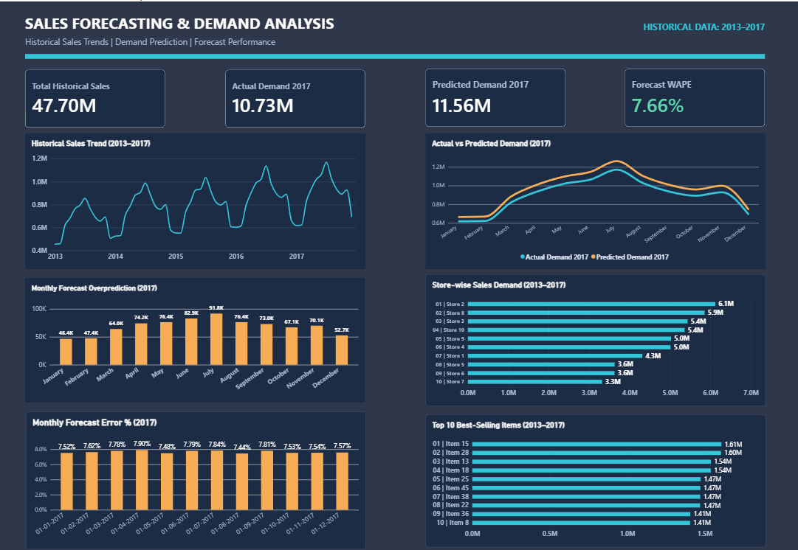

# Sales Forecasting & Demand Prediction Analysis

### End-to-End Data Analytics & Time-Series Forecasting Project

**Technologies:** Python | Pandas | NumPy | Matplotlib | PostgreSQL | SQL | Power BI | DAX

## Project Overview

This project analyzes historical retail sales data to understand demand patterns, identify seasonal trends, compare forecasting approaches, and evaluate demand prediction accuracy.

The end-to-end workflow covers data inspection, data cleaning, exploratory data analysis (EDA), forecasting data preparation, model evaluation, SQL analysis, and interactive Power BI dashboard development.

The objective is to transform historical sales records into actionable insights that can support inventory planning, demand forecasting, and business decision-making.

## Business Objectives

- Analyze historical sales trends and seasonal demand patterns.
- Understand store-wise and item-wise sales performance.
- Prepare time-series data for demand forecasting.
- Evaluate multiple forecasting approaches using historical validation periods.
- Compare actual and predicted demand.
- Measure forecasting accuracy and identify systematic prediction errors.
- Build an interactive Power BI dashboard for business stakeholders.

## Dataset Information

**Source:** Kaggle — Store Item Demand Forecasting Challenge

| Attribute                   | Details                      |
| --------------------------- | ---------------------------- |
| Total Records               | 913,000                      |
| Historical Period           | January 2013 – December 2017 |
| Unique Stores               | 10                           |
| Unique Items                | 50                           |
| Total Historical Units Sold | 47,704,512                   |
| Data Frequency              | Daily                        |
| Forecast Evaluation Period  | 2017                         |

The dataset contains daily item-level sales records across multiple stores.

## Tools and Technologies

| Tool             | Purpose                                             |
| ---------------- | --------------------------------------------------- |
| Python           | Data cleaning, analysis, forecasting and validation |
| Pandas and NumPy | Data transformation and numerical operations        |
| Matplotlib       | Exploratory data visualization                      |
| PostgreSQL       | Structured data storage and analytical queries      |
| SQL              | Data validation, aggregation and business analysis  |
| Power BI         | Interactive dashboard development                   |
| DAX              | KPI and forecast error calculations                 |
| Git and GitHub   | Version control and project documentation           |

## Project Workflow

### 1. Data Inspection

Examined dataset dimensions, column types, date ranges, store and item coverage, and data quality characteristics.

### 2. Data Cleaning

Prepared historical sales records for analysis by validating fields, data types and time-series consistency.

### 3. Exploratory Data Analysis

Analyzed sales trends, seasonal patterns, store-level demand and item-level performance.

### 4. Forecasting Data Preparation

Prepared time-series aggregations and historical validation datasets to compare demand forecasting approaches.

### 5. Forecast Model Evaluation

Evaluated five forecasting approaches and selected the best-performing model based on validation results.

### 6. SQL Analysis

Loaded analytical datasets into PostgreSQL and completed 14 SQL analyses covering sales patterns, demand and forecasting performance.

### 7. Power BI Dashboard

Developed a dashboard with four KPI cards and six visualizations to communicate historical sales performance, forecast predictions and model accuracy.

## Forecasting Model Performance

The best-performing approach was the **Trend-Adjusted Seasonal Average** model.

| Evaluation Metric       |                          Result |
| ----------------------- | ------------------------------: |
| Best Model              | Trend-Adjusted Seasonal Average |
| 2016 Validation WAPE    |                           3.37% |
| 2017 Validation WAPE    |                           7.66% |
| 2017 MAE                |                  2,253.06 units |
| 2017 RMSE               |                  2,328.11 units |
| Actual Demand — 2017    |                10,733,740 units |
| Predicted Demand — 2017 |             11,556,105.48 units |

**WAPE (Weighted Absolute Percentage Error)** measures total absolute forecasting error relative to actual demand.

A WAPE of 7.66% indicates that the total absolute forecast error was approximately 7.66% of actual demand during the 2017 evaluation period.

### Model Limitations

The selected model consistently overpredicted daily demand throughout 2017.

This systematic positive bias is important for business interpretation: using these forecasts without adjustment could lead to excess inventory or overestimated replenishment requirements.

Forecasting performance is based on historical validation, not demonstrated future production performance.

## Power BI Dashboard Preview



### Dashboard KPIs

| KPI                    |        Value |
| ---------------------- | -----------: |
| Total Historical Sales | 47.70M units |
| Actual Demand 2017     | 10.73M units |
| Predicted Demand 2017  | 11.56M units |
| Forecast WAPE          |        7.66% |

### Dashboard Visualizations

1. **Historical Sales Trend (2013–2017)** — Displays historical sales movement and seasonal demand patterns.
2. **Actual vs Predicted Demand (2017)** — Compares actual and forecast demand throughout the evaluation year.
3. **Monthly Forecast Overprediction (2017)** — Shows monthly differences between predicted and actual demand.
4. **Store-wise Sales Demand (2013–2017)** — Compares historical demand across 10 stores.
5. **Monthly Forecast Error % (2017)** — Shows monthly relative forecasting error.
6. **Top 10 Best-Selling Items (2013–2017)** — Highlights the highest-selling items by total units sold.

## Key Business Insights

### Seasonal Demand

Historical sales exhibit recurring seasonal patterns, demonstrating the importance of seasonality in demand forecasting.

### Store-Level Performance

Sales demand varies across stores. Store-level analysis helps identify locations with stronger historical demand and potential inventory requirements.

### Product-Level Performance

Item-level sales rankings identify high-volume products that may require closer inventory and replenishment monitoring.

### Forecasting Accuracy

The Trend-Adjusted Seasonal Average model achieved a 7.66% WAPE on the 2017 validation period.

### Forecast Bias

Predicted demand exceeded actual demand throughout 2017. Forecast bias should therefore be addressed before applying the model directly to inventory decisions.

## Business Recommendations

- Use seasonal sales patterns to support inventory planning.
- Monitor high-demand stores and items more closely.
- Track forecast accuracy over time rather than relying on one validation result.
- Investigate systematic overprediction before making replenishment decisions.
- Compare future forecasting approaches against the current baseline.
- Incorporate business factors such as promotions, holidays and stock availability when relevant data becomes available.

## Project Structure

```text
Sales-Forecasting-Demand-Prediction/
│
├── data/
├── notebooks/
│   ├── 01_Data_Inspection.ipynb
│   ├── 02_Data_Cleaning.ipynb
│   ├── 03_Exploratory_Data_Analysis.ipynb
│   └── 04_Forecasting_Data_Preparation.ipynb
│
├── sql/
│
├── dashboard/
│   └── Sales_Forecasting_Demand_Dashboard.pbix
│
├── reports/
│   └── Sales_Forecasting_Dashboard.png
│
└── README.md
```

_Note: The notebook names above illustrate the project workflow. The actual repository filenames should be verified before publishing._

## Future Improvements

- Evaluate additional time-series forecasting techniques.
- Introduce bias correction for systematic overprediction.
- Build store-item-level forecasts for more granular inventory decisions.
- Add holiday, promotion and external demand features where available.
- Automate forecasting refreshes and performance monitoring.

## Conclusion

This project demonstrates an end-to-end data analytics workflow combining Python, SQL, forecasting techniques and Power BI.

It highlights how historical sales analysis and model evaluation can support demand planning while emphasizing the importance of interpreting forecast error and bias before making operational decisions.

## Author

**Ankit Tripathi**

GitHub: https://github.com/Ankit-Tripathi-31

Project Repository: https://github.com/Ankit-Tripathi-31/Sales-Forecasting-Demand-Prediction
